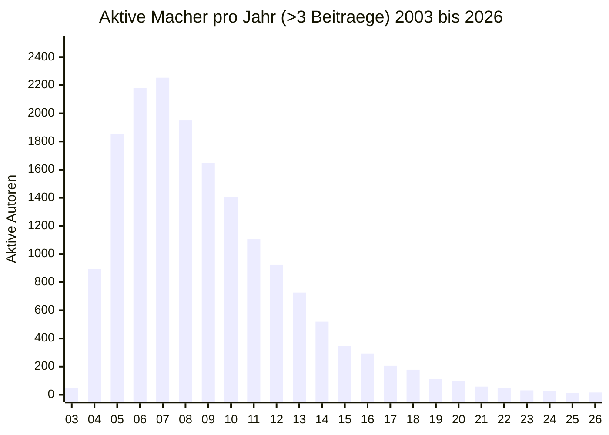

# 23 Jahre Roboternetz.de (2003 – 2026): Das Große Mechatronik-Jahrbuch & Die Ewige Hall of Fame

> **„Nicht die Systeme machen eine Gemeinschaft aus, sondern die Menschen, die ihr Wissen teilen.“**  
> *Eine datenbasierte historische Retrospektive über 23 Jahre deutsche Mechatronik- und Robotik-Kultur.*

---

## 1. Das EKG des Forums: Aktive Autoren pro Jahr (2003 – 2026)

Das folgende Diagramm visualisiert die Lebenskurve der Community. Erfasst sind alle Mitglieder, die im jeweiligen Jahr **mehr als 3 Beiträge** verfasst haben:



### Die visuelle Balkenübersicht:
```text
2003: █ (46)
2004: ████████ (894)
2005: ████████████████ (1.856)
2006: ███████████████████ (2.180)
2007: ████████████████████ (2.253)  <-- ALLZEIT-REKORD!
2008: █████████████████ (1.949)
2009: ██████████████ (1.648)
2010: ████████████ (1.403)
2011: ██████████ (1.105)
2012: ████████ (923)
2013: ██████ (726)
2014: ████ (519)
2015: ███ (345)  <-- Shop-Schließung
2016: ██ (293)
2017: █ (206)
2018: █ (178)  <-- Moppi steigt ein (Sofort #2)
2019: █ (111)  <-- Moppi (#2) & HaWe tragen das Forum
2020: █ (99)   <-- Moppi (#1 mit 769 Posts)
2021: ▏ (58)
2022: ▏ (46)
2023: ▏ (31)
2024: ▏ (27)
2025: ▏ (14)
2026: ▏ (16)   <-- Das Finale & die Bergung
```

---

## 2. Die Gesamtanalyse: Die Pyramide der Beteiligung

In den 23 Jahren des Bestehens wurden **über 620.000 Fachbeiträge** in rund **66.600 Diskussionsthemen** verfasst.  
Entgegen der nominellen Zahl von über 73.000 registrierten Benutzerkonten belegt die unbestechliche Datenanalyse, dass die Plattform von **22.012 tatsächlichen Autoren** getragen wurde:

| Beteiligungs-Kategorie | Anzahl Autoren | Anteil | Bedeutung für die Community |
| :--- | :---: | :---: | :--- |
| **Einmal-Fragesteller (Eintagsfliegen)** | **5.795** | **26,3 %** | Ein einziges Problem gelöst und nie wiedergekehrt. |
| **Gelegenheits-Fragesteller (2 bis 9 Posts)** | **10.645** | **48,4 %** | Punktuelle Fragen bei akuten Bastelprojekten. |
| **Engagierte Bastler (10 bis 99 Posts)** | **4.667** | **21,2 %** | Regelmäßige Werkstatt-Teilnehmer. |
| **Aktive Stamm-Macher (100 bis 999 Posts)** | **808** | **3,7 %** | Das verlässliche Rückgrat der Fachforen. |
| 👑 **Die Ewige Elite (über 1.000 Beiträge)** | **97** | **0,4 %** | **Die 97 Pioniere, die das gesamte Forum getragen haben!** |

---

## 3. Die Ewige Hall of Fame: Die 30 produktivsten Autoren aller Zeiten

Diese Mitglieder haben über zwei Jahrzehnte hinweg die tiefsten Spuren, Schaltungen und Lösungsansätze hinterlassen 🏆:

| Rang | Mitglied | Beiträge (Gesamt) | Erste Aktivität | Historische Rolle |
| :---: | :--- | :---: | :---: | :--- |
| **#01** | **Manf** | **11.632** | 2004 | Die unangefochtene wissenschaftliche Seele des Forums. |
| **#02** | **PICture** | **10.704** | 2005 | Unermüdlicher Dauer-Helfer über 15 Jahre. |
| **#03** | **oberallgeier** | **7.992** | 2007 | Mechanik-, Odometrie- und C-Experte. |
| **#04** | **Besserwessi** | **7.843** | 2005 | Elektronik- und Sensor-Analytiker. |
| **#05** | **PicNick** | **6.564** | 2004 | Software- und Steuerungs-Pionier. |
| **#06** | **Hubert.G** | **6.174** | 2006 | Hardware- und Motortreiber-Spezialist. |
| **#07** | **radbruch** | **5.387** | 2006 | Der legendäre Asuro-Tuner und langjährige Moderator. |
| **#08** | **021aet04 (Hannes)**| **4.833** | 2009 | Treuer Stammuser und Helfer der Neuzeit. |
| **#09** | **HaWe** | **4.655** | 2014 | Dominanter Beitrags-Schreiber der Jahre 2016–2019. |
| **#10** | **Richard** | **4.274** | 2006 | Analoge Schaltungstechnik & Praxis. |
| **#11** | **uwegw** | **4.157** | 2005 | Pionier der 2000er-Jahre. |
| **#12** | **Frank** | **4.121** | 2003 | Gründer (aktiv vor allem 2003–2004). |
| **#13** | **HannoHupmann** | **3.925** | 2006 | Regelungstechnik & Fahrwerke. |
| **#14** | **Ratber** | **3.905** | 2005 | Elektronik-Schwergewicht der Blütezeit. |
| **#15** | **Dirk** | **3.775** | 2004 | C-Control- & RP6-Experte. |
| **#16** | **damaltor** | **3.541** | 2006 | Top-Autor des Allzeit-Rekordjahres 2007. |
| **#17** | **Jon** | **3.408** | 2005 | Asuro- und Sensorik-Macher. |
| **#18** | **Kampi** | **3.279** | 2009 | Hardware- und Schnittstellen-Helfer. |
| **#19** | **Ceos** | **3.012** | 2007 | Software- und System-Begleiter. |
| **#20** | **SprinterSB** | **2.779** | 2005 | Assembler- & AVR-C-Spezialist. |
| **#21** | **linux_80** | **2.709** | 2005 | Linux- und Server-Einbindung. |
| **#22** | **RCO** | **2.627** | 2004 | Pionier der ersten Stunde. |
| **#23** | **i_make_it** | **2.531** | 2008 | Präzisions-Mechanik & CAD. |
| **#24** | **Florian** | **2.474** | 2004 | Frühe Bascom- und AVR-Entwicklung. |
| **#25** | **Klingon77** | **2.432** | 2006 | Metallbau, Fräsen & Passungen. |
| **#26** | **Andree-HB** | **2.428** | 2004 | 22 Jahre Treue von Tag 1 an. |
| **#27** | **Moppi** | **2.416** | 2018 | **mit an der Spitze der Spätphase** |
| **#28** | **recycle** | **2.367** | 2004 | Frühe Schaltungstechnik. |
| **#29** | **wkrug** | **2.278** | 2006 | Hardware-Ikone & aktivster Autor bis 2026. |
| **#30** | **squelver** | **2.231** | 2006 | Sensorik und Embedded C. |

---

## 📅 4. Das Jahrbuch: 23 Jahre Technik-Geschichte (4 Meilensteine pro Epoche)

### 🗓️ 2003 — 46 aktive Autoren
* **Historischer Kontext:** Gründung am 30. Oktober 2003. Die Ära der C-Control und ersten Bascom-Schaltungen beginnt im Webring-Zeitalter.
* **Die technischen Meilensteine:**
  1. **Conrad C-Control I (M-Unit 1.1 / 2.0):** Der dominierende Einstieg in die Mikrocontrollerwelt (CC-Basic).
  2. **Bascom-AVR:** Etabliert sich als leicht verständliche Basic-Alternative zu teuren C-Compilern.
  3. **L298N Bipolartreiber:** Erste H-Brücken-Schaltungen mit Zementwiderständen werden diskutiert.
  4. **ISP-Programmieradapter (Parallelport):** Flashen von AT90S2313 und ATmega8 über Druckerports (STK200-Standard).

---

### 🗓️ 2004 — 894 aktive Autoren
* **Historischer Kontext:** Etablierung des „RN-Standards“. Frank stellt RN-Control 1.4 vor. Manf stößt dazu und wird zum wissenschaftlichen Rückgrat.
* **Die technischen Meilensteine:**
  1. **RN-Control 1.4:** Das Hauptboard mit ATmega32, L298 und 10-poligem Wannenstecker-Standard.
  2. **RN-Motor & RN-Schrittmotor:** Erste modulare Treiber-Erweiterungen (L297/L298).
  3. **C-Control-Peak:** Letzter großer Höhepunkt der C-Control vor der totalen AVR-Übernahme.
  4. **Sharp GP2D12 Infrarot-Distanzsensoren:** Verdrängen einfache Stoßtaster als Nahbereichs-Abstandsmesser.

---

### 🗓️ 2005 — 1.856 aktive Autoren
* **Historischer Kontext:** Der ASURO-Boom bricht aus. Schüler und Studenten fluten das Forum. Entstehung des RN-Wissen-Wikis.
* **Die 4 technischen Meilensteine:**
  1. **ASURO (DLR / Arexx):** Der Bausatz des Jahrzehnts (2x Fototransistor-Liniensensor, IR-Transceiver, Odometrie).
  2. **RN-Wissen-Wiki:** Offizieller Start der strukturierten Wissensbasis für Robotik-Mathematik.
  3. **SRF04 / SRF08 Ultraschall-Sensoren:** Erste hochpräzise I2C-Laufzeitmessung für den Nahbereich.
  4. **AVR-GCC & WinAVR:** Schrittweiser Umstieg anspruchsvoller Programmierer von Bascom auf ANSI-C.

---

### 🗓️ 2006 — 2.180 aktive Autoren
* **Historischer Kontext:** Höhepunkt der diskreten Schaltungen. Frank gründet den Shop robotikhardware.de für Bausätze.
* **Die technischen Meilensteine:**
  1. **RN-MiniControl:** Kompakte Steck-Steuerung für Huckepack-Aufbauten.
  2. **Erste Servo-Hexapoden:** Hochkomplexe 18-Servo-Laufroboter mit inverser Kinematik auf ATmega128.
  3. **CMUCam / AVRCam:** Erste Experimente mit primitiven Farb-Tracking-Kameras auf Robotern.
  4. **Schrittmotor-Endstufen mit Vollmetall-Gehäusen:** Industrielle Treiber werden angebunden.

---

### 🗓️ 2007 — 2.253 aktive Autoren (HISTORISCHER ALLZEIT-REKORD!)
* **Historischer Kontext:** Höchste Dichte an autonomen Eigenbauten, Hexapoden und Sensor-Scannern. Oberallgeier meldet sich an.
* **Die technischen Meilensteine:**
  1. **Bascom-Allzeit-Peak:** Mehr als ein Viertel aller Forenbeiträge drehen sich um Bascom-Code.
  2. **ASURO-Allzeit-Peak:** Unzählige Modifikationen (Display-Aufsätze, Ultraschall-Erweiterungen).
  3. **Erscheinung des RP6 (Arexx):** Ankündigung des massiven Ketten-Nachfolgers für den ASURO.
  4. **Erste Lidar- und Lasertriangulations-Experimente:** Selbstgebaute Rundum-Scanner mit Laserpointern und Webcams.

---

### 🗓️ 2008 — 1.949 aktive Autoren
* **Historischer Kontext:** Arduino betritt den Weltmarkt. Das Forum verharrt weitgehend auf 8-Bit-AVRs mit ISP-Programmierern.
* **Die technischen Meilensteine:**
  1. **Arduino Duemilanove:** Erste zaghafte Erwähnungen von „Arduino“ im Forum.
  2. **Markteinführung des RP6 (Arexx):** Robuste Kettenplattform mit I2C-Erweiterungsbus und C-Bibliothek.
  3. **STM32 (ARM Cortex-M3):** Erste Erwähnung von 32-Bit-Mikrocontrollern für anspruchsvolle Regelung.
  4. **Bürstenlose DC-Motoren (BLDC):** Erste Experimente mit Modellbau-Außenläufern als Radantriebe.

---

### 🗓️ 2009 — 1.648 aktive Autoren
* **Historischer Kontext:** Der Arexx RP6 etabliert sich als Standard-Forschungsplattform. Hannes (021aet04) stößt zur Kern-Community.
* **Die technischen Meilensteine:**
  1. **RP6-M32 & RP6-WIFI:** Erweiterungsplatinen bringen den RP6 ins heimische WLAN.
  2. **BMA020 / ITG3200:** Erste günstige MEMS-Beschleunigungssensoren und Gyroskope via I2C.
  3. **Fendt Traktormeter (#43680):** wkrug startet seinen legendären Thread, der über 115.000 Hits sammelt.
  4. **Schaltregler (Step-Down LM2576 / LM2596):** Verdrängen schrittweise die ineffizienten 7805-Heizkörper.

---

### 🗓️ 2010 — 1.403 aktive Autoren
* **Historischer Kontext:** RP6-Allzeit-Peak (1.417 Posts). Intensive Diskussionen um Kaskadenregler und Odometrie-Genauigkeit.
* **Die technischen Meilensteine:**
  1. **Arduino Uno (R1):** Der blaue 8-Bit-Standard etabliert sich weltweit mit USB-Atmega16U2.
  2. **MultiWii-Projekt:** Flugsteuerungen auf Basis von Arduino Pro Mini und Nintendo-Wii-Sensoren.
  3. **Kaskadierte PID-Regler:** Mathematische Perfektionierung von Motor-Drehzahl- und Positionsregelungen.
  4. **LiPo-Akkus:** Lithium-Polymer-Zellen verdrängen endgültig die schweren NiMH- und Blei-Akkus.

---

### 🗓️ 2011 — 1.105 aktive Autoren
* **Historischer Kontext:** Letztes Jahr mit über 1.000 aktiven Autoren. Rechnerarchitekturen beginnen sich in Richtung ARM zu verschieben.
* **Die technischen Meilensteine:**
  1. **Erste RepRap- und 3D-Druck-Erwähnungen:** Erste Pioniere bauen 3D-Drucker (Mendel, Prusa Air) aus Gewindestangen.
  2. **MPU-6050:** InvenSense revolutioniert 6-Achs-IMUs mit integriertem Digital Motion Processor (DMP).
  3. **Wegbruch des ASURO:** Der ASURO verliert rapide an Bedeutung gegenüber fertigen Plattformen.
  4. **Kinect für Robotik (OpenNI):** Erste Bastler nutzen Microsofts 3D-Tiefenkamera für Raumkartierung.

---

### 🗓️ 2012 — 923 aktive Autoren
* **Historischer Kontext:** Verkauf des Raspberry Pi 1 startet. Die Zahl aktiver Bastler im Forum sinkt erstmals unter 1.000.
* **Die technischen Meilensteine:**
  1. **Raspberry Pi (Modell B, 256 MB RAM):** Ein vollwertiges Linux-Board für 35 Dollar verändert die Robotik für immer.
  2. **Bascom-Bruch:** Bascom verliert seine Dominanz und stürzt um 75 % gegenüber 2007 ab.
  3. **Mecanum-Allzeit-Peak:** Intensive Diskussionen über omnidirektionales Fahren ohne Lenkachse.
  4. **Bluetooth SPP (HC-05 / HC-06):** Drahtlose serielle Steuerung über Android-Smartphones wird Standard.

---

### 🗓️ 2013 — 726 aktive Autoren
* **Historischer Kontext:** Inka (Georg) wird aktiv. Diskussionen über Quadrocopter, MultiWii und Lasertriangulation dominieren.
* **Die technischen Meilensteine:**
  1. **Raspberry-Pi-Allzeit-Peak im Forum:** Linux-Bildverarbeitung mit OpenCV auf Robotern.
  2. **Wegbruch der RN-Control:** Franks 2004er-Platinenstandard wird kaum noch für Neubauten genutzt.
  3. **Arduino Mega 2560:** Wird zum Standard für 3D-Drucker-Steuerungen (RAMPS 1.4).
  4. **Pololu A4988 Schrittmotortreiber:** Etabliert das winzige StepStick-Format (15x20 mm) mit 1/16 Mikroschritt.

---

### 🗓️ 2014 — 519 aktive Autoren
* **Historischer Kontext:** HaWe stößt dazu. Der Markt wird spürbar von günstigen China-Komponenten und Breakouts geflutet.
* **Die technischen Meilensteine:**
  1. **ESP8266 (ESP-01):** Espressif schockiert die Welt mit einem 2-Euro-WLAN-Modul mit AT-Befehlen.
  2. **Arduino-Allzeit-Peak im Forum (1.139 Posts):** Arduino ist der unangefochtene Standard aller Bastlerfragen.
  3. **Autonome Staubsauger-Hacks:** Bastler zerlegen erste kommerzielle Roomba- und Neato-Roboter.

---

### 🗓️ 2015 — 345 aktive Autoren
* **Historischer Kontext:** WENDEPUNKT: Frank schließt im Oktober den Shop robotikhardware.de ('Platinen ausverkauft'). Teilnehmerzahl bricht auf 345 ein.
* **Die technischen Meilensteine:**
  1. **Wegbruch des RP6 (119 Posts):** Das Ende des letzten großen deutschen Kettenroboter-Bausatzes.
  2. **NodeMCU / Lua auf ESP8266:** Der WLAN-Chip wird zum vollwertigen, selbstständigen Controller.
  3. **DRV8825 Treiber:** 1/32 Mikroschritt löst den A4988 in vielen DIY-Projekten ab.
  4. **WS2812B „Neopixel“:** Digital adressierbare RGB-LEDs erobern Statusanzeigen und Roboteraugen.

---

### 🗓️ 2016 — 293 aktive Autoren
* **Historischer Kontext:** HaWe übernimmt die Spitzenposition bei den Beiträgen. Klassische Robotik weicht vermehrt 3D-Druck-Diskussionen.
* **Die technischen Meilensteine:**
  1. **ESP32 angekündigt:** Espressif stellt den Dual-Core-Nachfolger mit Bluetooth und massig GPIOs vor.
  2. **Erste STM32 „BluePill“-Welle:** 32-Bit-ARM-Controller für unter 2 Euro aus Asien fluten die Werkbänke.
  3. **Trinamic TMC2100 / TMC2130:** StealthChop revolutioniert Schrittmotoren (erstmals lautlose Antriebe).
  4. **Prusa i3 MK2:** Der 3D-Druck wird aus der Bastlerecke zum absolut verlässlichen Werkzeug.

---

### 🗓️ 2017 — 206 aktive Autoren
* **Historischer Kontext:** Foren-Aktivität sinkt auf rund 200 Autoren. Zunehmende Überalterung des Stammpersonals.
* **Die technischen Meilensteine:**
  1. **STM32-Allzeit-Peak im Forum:** Intensive Diskussionen um ARM-Register und HAL-Bibliotheken.
  2. **RPLidar A1 / 360°-Laser:** Erschwingliche 2D-Lidar-Scanner unter 100 Euro für Roboter-Navigation.
  3. **VL53L0X Time-of-Flight:** Miniatur-Laserlaufzeitsensoren verdrängen die alten Sharp-IR-Sensoren.
  4. **MQTT & Node-RED:** Etablieren sich als das Standard-Übertragungsprotokoll für vernetzte Maker-Daten.

---

### 🗓️ 2018 — 178 aktive Autoren
* **Historischer Kontext:** DIE MOPPI-ÄRA BEGINNT: Moppi steigt ein und wird sofort #2. Einführung der DSGVO im Mai führt zu administrativer Abschottung.
* **Die technischen Meilensteine:**
  1. **ESP8266-Allzeit-Peak im Forum:** Massiver Einsatz für IoT, Garten und Werkstattprojekte.
  2. **Moppis Thread 72595 & 72831:** Programmierbare, autonome Rollosteuerung mit Arduino und NEMA17.
  3. **Wegbruch des Raspberry Pi (45 Posts)**.
  4. **TMC2208:** Lautlose Schrittmotortreiber werden im Consumer-Bereich zum Massenstandard.

---

### 🗓️ 2019 — 111 aktive Autoren
* **Historischer Kontext:** Moppi treibt moderne Themen voran (Rollosteuerung, FFN-Netze, NodeMCU). HaWe und Moppi tragen die Diskussionen.
* **Die technischen Meilensteine:**
  1. **ESP32-Allzeit-Peak im Forum:** Etablierung als Standard-Controller für IoT + Mechatronik.
  2. **Neuronale Netze Allzeit-Peak:** Moppi startet Thread 74167 über FFNs und Training.
  3. **ESP32-CAM (AI-Thinker):** Für 5 Euro inklusive OV2640-Kamera – Video-Streaming wird zum Pfennigartikel.
  4. **TMC2209 Markteinführung:** Der König der Schrittmotortreiber mit StallGuard (Sensorless Homing) erscheint.

---

### 🗓️ 2020 — 99 aktive Autoren
* **Historischer Kontext:** MOPPI WIRD #1 ALLER AUTOREN (769 Posts). Große Debatte um die 'Zukunft des Forums' (Thread 75392). Stillstand der Forensoftware.
* **Die technischen Meilensteine:**
  1. **SLAM & Lidar Allzeit-Peak:** Moppis Thread 75022 entzaubert das SLAM-Dogma für Wohnungen.
  2. **3D-Druck-Allzeit-Peak im Forum:** Moppi Thread 74725 über Schichthaftung und Chassis-Konstruktion.
  3. **Geschlossene Regelkreise mit NEMA17 (Moppi):** Gabellichtschranke (100 Schlitze) als virtueller Drehmomentsensor.
  4. **Fahrplattform mit Tandem-Achsen:** Moppis Nachweis der rein passiven mechanischen Spurhaltegeometrie.

---

### 🗓️ 2021 — 58 aktive Autoren
* **Historischer Kontext:** Teilnehmerzahl fällt unter 60. Inka baut am Schlafapnoe-Sensor. Moppi erforscht Schaltungen und Entstörung.
* **Die technischen Meilensteine:**
  1. **Wegbruch von Arduino (130 Posts):** Klassische 8-Bit-Arduinos werden von 32-Bit-Plattformen überholt.
  2. **Wegbruch von 3D-Druck, Lidar und SLAM:** Die Diskussionen im Forum ebben mangels neuer Projekte ab.
  3. **Inkas Schlafapnoe-Detektor:** Prototypenbau mit Wemos D1 mini.

---

### 🗓️ 2022 — 46 aktive Autoren
* **Historischer Kontext:** Nur noch 46 aktive Macher. Frank fokussiert sich primär auf seinen YouTube-Kanal (@tueftler).
* **Die technischen Meilensteine:**
  1. **Raspberry Pi Pico (RP2040):** Der 1-Euro-Dual-Core mit frei programmierbaren PIO-Zustandsmaschinen.
  2. **Balkonkraftwerk-Welle:** Das Forum diskutiert vermehrt über Wechselrichter (Hoymiles) und Einspeisung.
  
---

### 🗓️ 2023 — 31 aktive Autoren
* **Historischer Kontext:** Manf zieht sich Ende 2023 zunehmend zurück. Inkas letzte YouTube-Videos und Forenbeiträge. Kaum noch 30 Aktive.
* **Die technischen Meilensteine:**
  1. **Inkas Video '2023_03_01':** Georgs letztes Projekt: Der faltbare Solar-Mecanum-Rover.
  2. **ChatGPT & LLM-Explosion:** Das weltweite Ende reiner Frage-Antwort-Foren zeichnet sich ab.
  3. **SimpleFOC auf BLDC:** Bürstenlose Motoren mit FOC-Regelung verdrängen Schrittmotoren in High-End-Gelenken.

---

### 🗓️ 2024 — 27 aktive Autoren
* **Historischer Kontext:** All-Inkl kündigt Abschaltung alter PHP-Versionen an. wkrug wird aktivster Poster. Völlige Stagnation der Plattform.
* **Die technischen Meilensteine:**
  1. **ESP32-S3 taucht erstmals im Forum auf**
  2. **TMC2209 taucht erstmals im Forum auf** 5 Jahre nach Markteinführung erreicht der Treiber das Forum.
  3. **LiFePO4-Speicher-DIY:** 12V-Akkus mit BMS verdrängen Blei-Gel-Akkus.

---

### 🗓️ 2025 — 14 aktive Autoren
* **Historischer Kontext:** Das Forum erreicht mit nur 14 aktiven Autoren den historischen Tiefpunkt.
* **Die technischen Meilensteine:**
  1. **Feetech STS3215 Bus-Servos:** Etablieren sich in der Welt als offener Standard für bezahlbare Roboterarme.
 
---

## 🤝 Unser Dank und der Blick nach vorn

Allen voran gebührt **Manf** (mit über 11.600 unermüdlichen Fachbeiträgen die unangefochtene Seele des Forums), **PICture**, **oberallgeier**, **Besserwessi**, **PicNick**, **radbruch**, **Hannes (021aet04)**, **HaWe**, **wkrug**, **Inka**, **Moppi** und all den ungenannten Pionieren unser tiefster Dank für 23 Jahre geteiltes Wissen.

Das alte Forum mag seine Tore schließen – aber euer Geist leben in der unabhängigen Community weiter!
